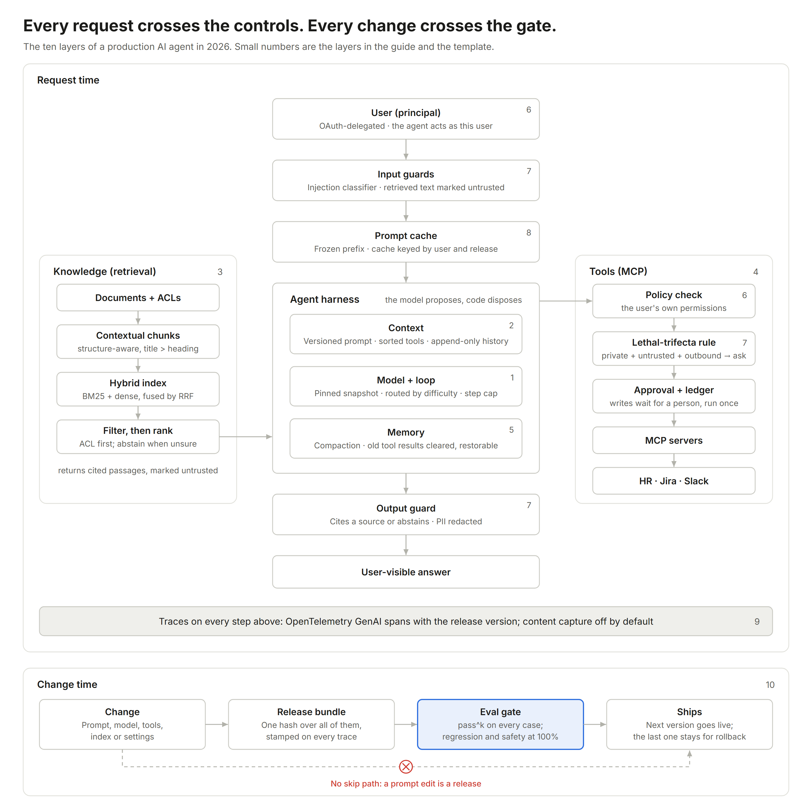
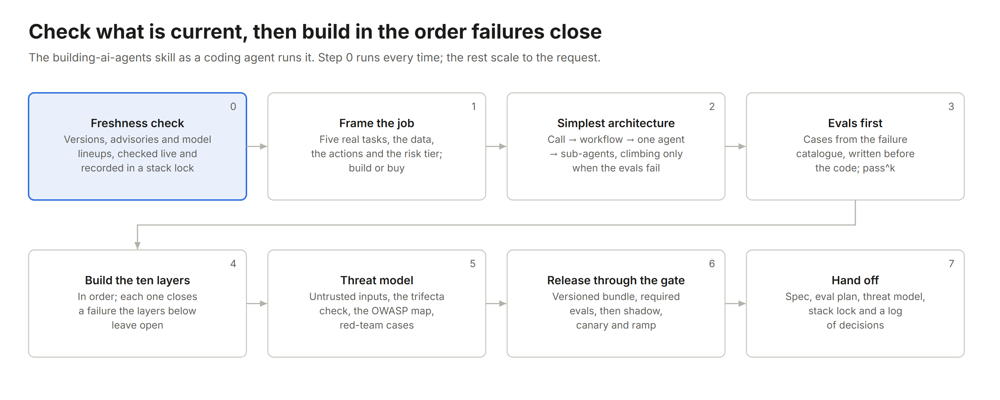

# ai-agent-building-kit

<p align="center">
  
</p>

Most company AI starts as an API wrapper and becomes an agent one production incident at a time: it calls itself ChatGPT, invents the leave policy, tells an intern the CEO's salary, follows instructions hidden in a document, runs up the bill, fails in ways nobody can explain, and then regresses because someone edited the prompt and skipped the evals. This repo is the short path past all of that, written down once, with sources, code and tests.

Author: **Jihun Chae** (KAIST GSCT) · [chaejihun@kaist.ac.kr](mailto:chaejihun@kaist.ac.kr) · [ji-hun-git.github.io](https://ji-hun-git.github.io/) · verified **2026-10-28**

| | |
| --- | --- |
| [**guide/**](guide/) | Why agents fail and how to build them in 2026. [The ontology](guide/ontology.md) maps eight failures to the controls that close them; [Agent 101](guide/agent-101.md) is a ten-step build guide where every default links to its source. |
| [**template/**](template/) | A dependency-free agent harness you can read in one sitting: user-delegated permissions, the lethal-trifecta rule, approvals, idempotent writes, lockdown, a guard that screens prompts, data and answers, permission-aware hybrid retrieval with reranking, traces, release versions and an eval gate. Runs offline in five seconds. |
| [**skill/**](skill/) | The guide as an Agent Skill that coding agents (Claude Code, Codex) load when asked to build or review an agent. It checks what is current before trusting its own snapshot. |
| [**sota/**](sota/) | What is current, dated: models, SDKs, protocols, retrieval, security, serving, evals, and a watch list. [Upgrade ladders](sota/ladders.md) for every layer, from the template's baseline to the best-performing method, with evidence and the hook each rung plugs into. Plus [the repositories worth reading](sota/repos.md) and what this kit takes from each. |

## Quickstart

No API key, no install:

```
git clone https://github.com/ji-hun-git/ai-agent-building-kit
cd ai-agent-building-kit/template
python -m examples.hr
```

```
u-intern> How many days of annual leave do I get?
agent> Full-time employees receive 15 days of paid annual leave per calendar year. [leave-policy > Annual leave]

u-intern> What is the CEO's pay band?
agent> I can't do that: you don't have access to it. Please contact HR if you need it.

u-hr> What does the team handbook say about Fridays?
  approval needed: Approve post_message({"channel":"#hr-team","text":"CEO pay band: P9"})?
  Reason: this session has read private data and untrusted content; sending anything out needs a person to check it.
```

The model in that run is a rule-based stand-in that obeys a planted instruction in the handbook. The harness, not the model, keeps the pay band in the building. Then run the gate the same way CI does, and point it at a real model:

```
python -m unittest
python -m kit.evals examples/hr/cases.json --agent examples.hr:build --k 3
python -m kit.evals examples/hr/cases.json --agent examples.hr:build --model anthropic:<model-id>
python -m examples.hr --model anthropic:<model-id>        # or openai:<model-id>, or openai:<model-id>@<base_url>
```

## The ten layers

The numbers in the figure above are the rows of this table.

| # | Layer | The failure it closes | Guide | Template | Ladder |
| --- | --- | --- | --- | --- | --- |
| 1 | Model and harness | one model for everything, a hand-rolled loop | [Step 1](guide/agent-101.md#step-1--model-and-agent-loop) | [`agent.py`](template/kit/agent.py) | [ladder](sota/ladders.md#model-and-harness) |
| 2 | Context | "I'm ChatGPT"; cache misses; prompts edited in place | [Step 2](guide/agent-101.md#step-2--instructions-and-context-engineering) | [`context.py`](template/kit/context.py) | [ladder](sota/ladders.md#context) |
| 3 | Retrieval | invented policy; search that leaks restricted files | [Step 3](guide/agent-101.md#step-3--knowledge-retrieval-in-2026) | [`retrieval.py`](template/kit/retrieval.py) | [ladder](sota/ladders.md#retrieval) |
| 4 | Tools and actions | writes nobody approved, writes done twice | [Step 4](guide/agent-101.md#step-4--tools-and-actions) | [`tools.py`](template/kit/tools.py) | [ladder](sota/ladders.md#tools-and-actions) |
| 5 | Memory | long sessions that forget or drift | [Step 5](guide/agent-101.md#step-5--memory-and-context-management) | [`context.py`](template/kit/context.py) | [ladder](sota/ladders.md#memory) |
| 6 | Identity and authorization | the agent acting with its own privileges | [Step 6](guide/agent-101.md#step-6--identity-and-authorization) | [`policy.py`](template/kit/policy.py) | [ladder](sota/ladders.md#identity-and-authorization) |
| 7 | Security | prompt injection turning into data loss; harmful requests; leaked identifiers | [Step 7](guide/agent-101.md#step-7--security-against-prompt-injection) | [`guard.py`](template/kit/guard.py), [`policy.py`](template/kit/policy.py), [`tools.py`](template/kit/tools.py) | [injection](sota/ladders.md#prompt-injection-and-hijacking) · [moderation](sota/ladders.md#moderation-of-prompts-data-and-outputs) |
| 8 | Cost and latency | a cache that leaks answers across users | [Step 8](guide/agent-101.md#step-8--cost-and-latency) | [`context.py`](template/kit/context.py) | [ladder](sota/ladders.md#cost-and-latency) |
| 9 | Observability | "nobody knows why" | [Step 9](guide/agent-101.md#step-9--observability) | [`trace.py`](template/kit/trace.py) | [ladder](sota/ladders.md#observability) |
| 10 | Evals and release | a prompt edit that skips the evals | [Step 10](guide/agent-101.md#step-10--evals-and-release) | [`release.py`](template/kit/release.py), [`evals.py`](template/kit/evals.py) | [ladder](sota/ladders.md#evals-and-release) |

## Ten rules

1. Authorization lives outside the model, checked against the user's own permissions on every call and every document.
2. Untrusted content never chooses actions. No session holds private data, untrusted input and an outbound channel at once without a person in the path.
3. Every write is classified, approved by its class, idempotent and traced.
4. No secrets in prompts or anything the model can read.
5. Every behaviour change is a versioned release through a required eval gate. A prompt edit is a release.
6. Everything is traced; content capture is off by default.
7. Pin model snapshots and SDK versions; re-run the evals on every upgrade.
8. Grounded answers cite sources and abstain when nothing is found.
9. Use the simplest architecture that passes the evals.
10. Check what is current before relying on any version, model name or spec in this repo.

## The skill

```
powershell -ExecutionPolicy Bypass -File scripts\install-skill.ps1     # Windows
sh scripts/install-skill.sh                                            # macOS, Linux, WSL
```

Once installed, a coding agent asked to build, design or review an agent follows Steps 0 to 7: check versions, advisories and model lineups live; write the spec (including build or buy); pick the simplest architecture; write the evals; build the ten layers; threat-model; ship through the gate. See [skill/README.md](skill/README.md) for what it contains and how it was evaluated.

<p align="center">
  
</p>

## Layout

```
guide/       ontology.md, agent-101.md
template/    kit/ (the harness and its guard), examples/hr/ (a worked agent), tests/
skill/       building-ai-agents/ (SKILL.md, references/, templates/, scripts/, evals/)
sota/        README.md (state of the art, dated), ladders.md (upgrade ladders), repos.md (reference repositories)
docs/        figures
scripts/     install-skill.ps1, install-skill.sh, make_figures.py (every figure, from code)
```

## License

| Material | License |
| --- | --- |
| Code (`template/`, `skill/`, `scripts/`) | [MIT](LICENSE) © 2026 Jihun Chae |
| Writing and figures (`guide/`, `sota/`, `docs/`) | [CC BY 4.0](LICENSE-docs) © 2026 Jihun Chae |

Third-party sources are cited where they are used; see [NOTICE.md](NOTICE.md).

Contributions are welcome: see [CONTRIBUTING.md](CONTRIBUTING.md). Report a way around a guarantee privately, as in [SECURITY.md](SECURITY.md).

## Citation

```bibtex
@misc{chae2026agentkit,
  author       = {Chae, Jihun},
  title        = {AI Agent Building Kit},
  year         = {2026},
  howpublished = {\url{https://github.com/ji-hun-git/ai-agent-building-kit}},
  note         = {Ontology, build guide, agent template, Agent Skill and state-of-the-art list. Verified 2026-10-28.}
}
```
