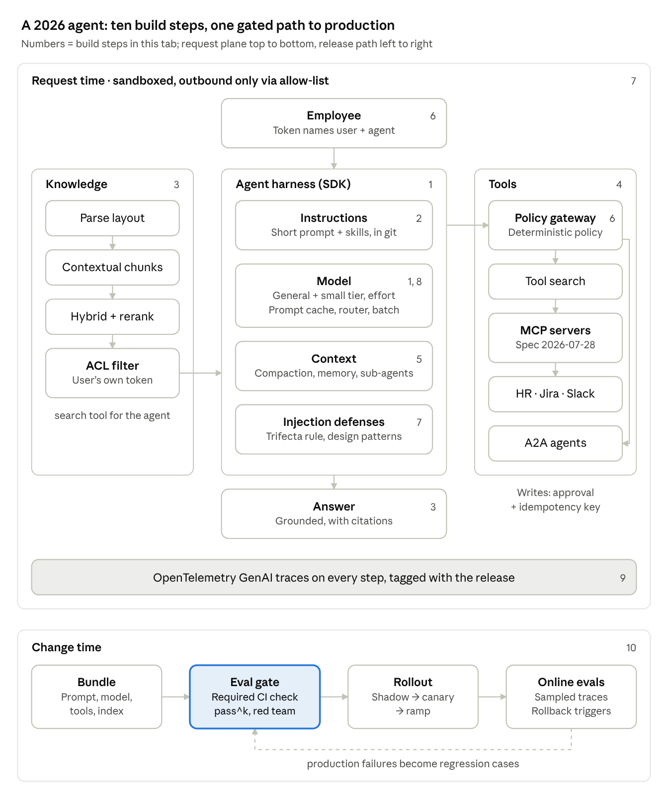

# Build an AI agent: 101 (state of the art, October 2026)

Jihun Chae · verified 2026-10-27

## At a glance

Build the agent on a vendor harness, give it permission-filtered retrieval and gated tools, sandbox the whole request path, trace every step, and ship every change through a required eval gate. The ten steps below follow that order; each ends with what it replaces from the build in the [ontology](ontology.md).

A request runs down the centre and pulls knowledge from the left and tools from the right, all inside a sandbox. Every change runs along the bottom, and failures found in production feed back into the eval gate.

## Step 1 · Model and agent loop

Start on the vendor's general model, send sub-agent and routing work to its small tier, and build on a vendor harness rather than a hand-written loop. Each major vendor now ships a four-tier family; Anthropic and OpenAI offer 1M-token context.

| Vendor | General default | Small tier | Harness |
| --- | --- | --- | --- |
| Anthropic | Claude Opus 5.5; Fable 5.1 only when evals at higher effort fall short ([models](https://platform.claude.com/docs/en/about-claude/models/overview)) | Haiku 5.5 | [Claude Agent SDK](https://code.claude.com/docs/en/agent-sdk/overview) (Claude Code as a library); hosted [Managed Agents](https://platform.claude.com/docs/en/managed-agents/overview) in beta |
| OpenAI | GPT-6 Astra or GPT-6.1 Sol ([models](https://developers.openai.com/api/docs/models)) | GPT-6 Luna | [Agents SDK](https://openai.github.io/openai-agents-python/) v0.24: handoffs, guardrails, sessions, sandbox agents, tracing, compaction |
| Google | Gemini 4 Argon or Gemini 3.8 Flash ([models](https://ai.google.dev/gemini-api/docs/models)) | Gemini 3.5 Flash-Lite | [ADK](https://adk.dev/) 2.x: graph workflows, A2A, evaluation |
| Microsoft | Any of the above | Any small tier above | [Agent Framework](https://learn.microsoft.com/en-us/agent-framework/overview/), successor to Semantic Kernel and AutoGen |
| Provider-neutral | Open weights: MiMo-V2.6-Pro, Qwen3.8 Max, GLM-5.3, DeepSeek V4.1, too close to rank ([BenchLM](https://benchlm.ai/best/open-source)) | Smaller open-weight models | [LangGraph](https://docs.langchain.com/oss/python/langgraph/overview) 1.2 with Deep Agents |

- **Reasoning effort.** Set a named effort level, not a token budget: Claude low to max ([effort](https://platform.claude.com/docs/en/build-with-claude/effort)), OpenAI low to max, Gemini `thinking_level` ([thinking](https://ai.google.dev/gemini-api/docs/thinking)). Defaults shift between releases, so re-run evals per level after each upgrade.
- **Structured outputs.** JSON Schema enforced by constrained decoding, plus strict tool schemas: Claude `output_config.format` ([docs](https://platform.claude.com/docs/en/build-with-claude/structured-outputs)), OpenAI `text.format` with `strict: true` ([docs](https://developers.openai.com/api/docs/guides/structured-outputs)). Only refusals and truncation break the schema.
- **Pin versions.** The Anthropic and OpenAI agent SDKs are still 0.x and release almost daily ([releases](https://github.com/openai/openai-agents-python/releases)).

**Replaces:** one model for every call, token thinking budgets, JSON mode with retry loops, and a raw chat loop around the API.

## Step 2 · Instructions and context engineering

The system prompt shrinks to identity and principles; procedures move into skills that load only when needed; and every prompt is a versioned file in git. Anthropic's rule is to give the model the smallest set of high-signal tokens that does the job ([context engineering](https://www.anthropic.com/engineering/effective-context-engineering-for-ai-agents)).

1. **System prompt.** Short and sectioned: name, persona, tone, scope, refusal rules. Pitch it between hard-coded rules and vague guidance; keep tools few and non-overlapping; fetch facts on demand instead of pasting them in.
2. **Skills for procedures.** Package each task procedure (file a leave request, triage a ticket) as an [Agent Skill](https://agentskills.io/): a `SKILL.md` folder whose description loads first and whose body loads when relevant. Skills went GA on the Claude API on 2026-08-19 ([release notes](https://platform.claude.com/docs/en/release-notes/overview)); OpenAI's Codex and ChatGPT use the same format ([OpenAI](https://learn.chatgpt.com/docs/build-skills)).
3. **AGENTS.md for repositories.** Coding agents read build, test and style rules from [AGENTS.md](https://agents.md/), now stewarded by the Linux Foundation's Agentic AI Foundation and used in over 60,000 projects.
4. **Prompts as releases.** Keep prompts in git with pull-request review, release tags and feature flags, and run evals on every publish (Step 10). Hosted prompt registries are fading: OpenAI shuts down its `v1/prompts` objects on 2026-11-30 ([prompting guide](https://developers.openai.com/api/docs/guides/prompting)).

**Replaces:** one long system prompt holding persona, policy text and every procedure, edited in place without review.

## Step 3 · Knowledge: retrieval in 2026

"Chunk, embed, top-k cosine, stuff into the prompt" is gone. The 2026 default parses layout, adds context to every chunk, runs hybrid search, reranks a wide candidate set, filters by the user's permissions, and exposes all of it to the agent as a search tool. In Anthropic's tests, contextual chunks + hybrid search + reranking cut top-20 retrieval failures by 67% against plain embeddings ([Contextual Retrieval](https://www.anthropic.com/news/contextual-retrieval)).

1. **Parse layout first.** A [Docling](https://github.com/docling-project/docling)-style parser keeps reading order, tables and headings, with OCR. For slides and scans, embed the page image instead ([ColPali](https://arxiv.org/abs/2407.01449)); Cohere reports [Embed 5](https://cohere.com/blog/embed-5) at 85.8 vs 75.5 for OpenAI 3-large on ViDoRe V3 (vendor figure).
2. **Chunk by structure, add context to each chunk.** Prepend 50–100 tokens of LLM-written document context to every chunk: top-20 failures fell 35% ([Contextual Retrieval](https://www.anthropic.com/news/contextual-retrieval)). [Late chunking](https://arxiv.org/abs/2409.04701) is the cheaper option with no extra LLM calls.
3. **Hybrid first stage.** Dense vectors + BM25 over the contextualised chunks: failures down 49%. Open multilingual embedder [Harrier-OSS-v1-27B](https://blogs.bing.com/search/April-2026/Microsoft-Open-Sources-Industry-Leading-Embedding-Model) led MTEB v2 in April 2026.
4. **Retrieve wide, rerank narrow.** About 150 candidates down to 20. New rerankers: [Cohere Rerank 5](https://cohere.com/blog/rerank-5) (Oct 2026: calibrated scores, so cut by threshold instead of fixed k; passage spans), [Voyage rerank-3](https://blog.voyageai.com/2026/09/30/rerank-3/) (Sep), [Jina v3.5](https://jina.ai/en-US/news/jina-reranker-v3-5-faster-listwise-reranking-hybrid-attention-self-distillation/) (Aug, non-commercial weights).
5. **Plan the query when questions are compound.** An LLM splits the question into subqueries, each searched and reranked in parallel, then merged with references ([Azure agentic retrieval](https://learn.microsoft.com/en-us/azure/search/agentic-retrieval-overview), preview). It adds latency; no gain figure is published.
6. **Make retrieval a tool.** The agent searches repeatedly and loads content just in time ([context engineering](https://www.anthropic.com/engineering/effective-context-engineering-for-ai-agents)). Managed options: [OpenAI file search](https://developers.openai.com/api/docs/guides/tools-file-search), [Gemini File Search](https://ai.google.dev/gemini-api/docs/file-search), Azure knowledge bases over MCP.
7. **Filter by permission inside the index.** Ingest document ACLs and sensitivity labels onto every chunk and enforce them at query time with the user's own token ([Azure document-level access](https://learn.microsoft.com/en-us/azure/search/search-document-level-access-overview)). Permission changes apply only after the index re-syncs.
8. **Cite and evaluate.** Measure retrieval recall@k separately from faithfulness and groundedness ([RAGAS](https://docs.ragas.io/en/stable/concepts/metrics/available_metrics/)); require citations in answers.

When the default is the wrong tool:

| Approach | Use when | Evidence |
| --- | --- | --- |
| Graph or tree RAG (GraphRAG, LazyGraphRAG, HippoRAG 2, RAPTOR) | Global, multi-hop, comparison and timeline questions | Plain RAG wins fact lookup, 60.9 vs 49.3; HippoRAG 2 wins complex reasoning, 53.4 vs 42.9; GraphRAG global search used \~331K prompt tokens vs \~0.9K ([study](https://arxiv.org/html/2506.05690v3)). [LazyGraphRAG](https://www.microsoft.com/en-us/research/blog/lazygraphrag-setting-a-new-standard-for-quality-and-cost/) indexes at about vector-RAG cost |
| Agentic keyword search (grep, BM25 as tools) | Code; small or fast-changing corpora | A keyword-only agent reached 94.5% of vector RAG's faithfulness ([AWS](https://arxiv.org/abs/2602.23368v1)); Claude Code reportedly dropped its vector index over staleness and security (second-hand, [vendor talk](https://www.ai.engineer/talks/zKk7sDMGDEQ-benchmarking-semantic-code-retrieval-on-claude)) |
| Long context, no retrieval | Corpus under about 200K tokens, with prompt caching | All 18 models tested did better on focused \~300-token inputs than on full \~113K inputs ([Context Rot](https://www.trychroma.com/research/context-rot)); no approach wins everywhere, so route per query ([LaRA](https://arxiv.org/abs/2502.09977)) |

**Upgrade ladder:** [retrieval](../sota/ladders.md#retrieval) orders these methods from the template's baseline (contextual chunks, ACL filter, BM25, abstain) through hybrid search, reranking with a calibrated threshold, page images, learned sparse and late interaction to agentic and multi-hop search, with the methods that no longer pay off (HyDE, RAG-Fusion, Self-RAG) and the controls against poisoned documents.

## Step 4 · Tools and actions

Connect systems through MCP servers built to the 2026-07-28 spec, load tools on demand instead of all at once, use A2A only for other teams' agents, and gate every write. MCP and A2A are both governed by the Linux Foundation's Agentic AI Foundation ([AAIF](https://www.linuxfoundation.org/press/linux-foundation-announces-the-formation-of-the-agentic-ai-foundation)).

- **MCP, current spec.** [2026-07-28](https://modelcontextprotocol.io/specification/2026-07-28/changelog) is stateless: no `initialize` handshake, no sessions, so servers sit behind load balancers and gateways. It adds `server/discover` for server identity, Multi Round-Trip Requests (replacing server-initiated elicitation), OpenTelemetry trace context and a Tasks extension. It deprecates Roots, Sampling, Logging, HTTP+SSE and dynamic client registration. Earlier steps: [2025-03-26](https://modelcontextprotocol.io/specification/2025-03-26/changelog) OAuth 2.1 and Streamable HTTP; [2025-06-18](https://modelcontextprotocol.io/specification/2025-06-18/changelog) structured tool output and elicitation; [2025-11-25](https://modelcontextprotocol.io/specification/2025-11-25/changelog) client metadata documents and experimental tasks.
- **Server catalog.** The public [MCP Registry](https://github.com/modelcontextprotocol/registry) is still in preview (API frozen at v0.1); keep a private allow-list of approved servers. OpenAI ([MCP tool](https://developers.openai.com/api/docs/guides/tools-connectors-mcp)), Google ([managed servers](https://cloud.google.com/blog/products/ai-machine-learning/announcing-official-mcp-support-for-google-services)) and Microsoft Copilot Studio support MCP.
- **Hundreds of tools.** Keep the 3–5 most-used tools loaded and defer the rest behind tool search ([Anthropic](https://platform.claude.com/docs/en/agents-and-tools/tool-use/tool-search-tool), [OpenAI](https://developers.openai.com/api/docs/guides/tools-tool-search)); selection degrades past 30–50 tools, and deferral cut definition tokens by about 85% ([advanced tool use](https://www.anthropic.com/engineering/advanced-tool-use)). Add 1–5 usage examples to complex tools. For bulk work, let the model write code that calls tools ([programmatic tool calling](https://platform.claude.com/docs/en/agents-and-tools/tool-use/programmatic-tool-calling), GA; [code execution with MCP](https://www.anthropic.com/engineering/code-execution-with-mcp)), which is not a security boundary.
- **Agent-to-agent.** [A2A](https://github.com/a2aproject/A2A/releases) 1.0 (Mar 2026; 1.0.1 May) adds signed Agent Cards, multi-tenancy and PKCE OAuth, with 150+ organisations and support in Azure AI Foundry, Copilot Studio and Bedrock AgentCore ([LF](https://www.linuxfoundation.org/press/a2a-protocol-surpasses-150-organizations-lands-in-major-cloud-platforms-and-sees-enterprise-production-use-in-first-year)). Use it for opaque agents run by others; use MCP for tools.
- **Computer and browser use, last.** API or MCP first, then a browser toolset, then full desktop control in a VM. Anthropic's GA [`computer_toolset_20260801` and `browser_toolset_20260801`](https://platform.claude.com/docs/en/agents-and-tools/tool-use/computer-use-tool), OpenAI's [`computer` tool](https://developers.openai.com/api/docs/guides/tools-computer-use), Gemini [computer use](https://ai.google.dev/gemini-api/docs/computer-use) (preview); all require confirmation before consequential actions.
- **Safe writes.** Classify each tool as read, reversible write or irreversible, and mirror it in MCP tool annotations. Gate writes with the SDK's approval hooks: Claude Agent SDK [permissions](https://code.claude.com/docs/en/agent-sdk/permissions) (hooks, allow/ask/deny rules, `canUseTool`), OpenAI `needs_approval` with durable run state ([human-in-the-loop](https://openai.github.io/openai-agents-python/human_in_the_loop/)). Require idempotency keys, because an approval does not guarantee the action runs exactly once.

**Replaces:** stateful MCP sessions, every tool definition loaded up front, bespoke webhooks between agents, and writes that run without a confirmation step.

## Step 5 · Memory and context management

Long sessions are now handled by the provider: server-side compaction, clearing of stale tool results, a file-style memory for facts that must survive, and sub-agents that keep exploration out of the main context. Anthropic's compaction docs note that response quality degrades as a conversation grows ([compaction](https://platform.claude.com/docs/en/build-with-claude/compaction)).

1. **Compaction.** Summarise old turns on the server: Anthropic on-demand compaction (beta, `compact-2026-09-04`), or OpenAI `compact_threshold` and the `/responses/compact` endpoint ([OpenAI](https://developers.openai.com/api/docs/guides/compaction)).
2. **Context editing.** In tool-heavy loops, clear old tool results automatically ([context editing](https://platform.claude.com/docs/en/build-with-claude/context-editing)).
3. **Durable memory.** Keep facts that must outlive a summary in a file-style store the agent reads and writes: Claude's [memory tool](https://platform.claude.com/docs/en/agents-and-tools/tool-use/memory-tool) and managed memory stores, or Google ADK [Memory Bank](https://adk.dev/sessions/memory/). Third-party memory (mem0, Letta, Graphiti) is now optional.
4. **Sub-agents.** Hand searches and exploration to low-effort sub-agents that return a short result, so the main agent's context stays small ([context engineering](https://www.anthropic.com/engineering/effective-context-engineering-for-ai-agents)).

Memory is also an attack surface: memory poisoning is on the OWASP agentic list (Step 7), so memory writes are traced and reviewable.

**Replaces:** client-side summariser code (Anthropic deprecated its SDK-side compaction), and full chat history resent on every turn.

## Step 6 · Identity and authorization

The agent gets its own identity and acts with a token that names both the user and the agent. Every document and tool call is then checked against that user's permissions outside the model.

- **MCP authorization.** Build to the [MCP 2026-07-28 authorization spec](https://modelcontextprotocol.io/specification/2026-07-28/basic/authorization): OAuth 2.1, protected resource metadata (RFC 9728), the `resource` parameter on every token request (RFC 8707), audience checks, no token passthrough, minimal scopes with step-up on `insufficient_scope`. Register clients with Client ID Metadata Documents or pre-registration; dynamic client registration is deprecated.
- **Workforce sign-on.** Use the [Enterprise-Managed Authorization extension](https://raw.githubusercontent.com/modelcontextprotocol/ext-auth/main/specification/stable/enterprise-managed-authorization/2026-07-28/enterprise-managed-authorization.mdx): the company identity provider issues an identity assertion (ID-JAG) through token exchange (RFC 8693), and the MCP server's authorization server turns it into a token for that server alone. Okta, Auth0, Descope and Anthropic shipped support in Aug–Sep 2026, per [WorkOS](https://workos.com/blog/cross-app-access-converged-in-eight-days) (a vendor source).
- **Agent identity.** Give each agent a workload identity (WIMSE/SPIFFE, or [Microsoft Entra Agent ID](https://learn.microsoft.com/en-us/entra/agent-id/identity-platform/what-is-agent-id) with a human sponsor). Keep credentials short-lived and out of the model's context; delegated tokens carry both user and agent (the `act` claim), per [draft-klrc-aiagent-auth-03](https://datatracker.ietf.org/doc/html/draft-klrc-aiagent-auth-03), now the working-group draft [draft-ietf-wimse-aims](https://datatracker.ietf.org/doc/draft-ietf-wimse-aims/) (Sep 2026).
- **Permission-aware retrieval.** Check the user's right to every retrieved document before the model sees it: [OpenFGA](https://openfga.dev/docs/modeling/agents/rag-authorization) BatchCheck after retrieval, or ListObjects before it.
- **Tool-call policy.** Check each call at a gateway with deterministic policy, such as Cedar or session-aware rules ([AWS AgentCore Policy](https://docs.aws.amazon.com/bedrock-agentcore/latest/devguide/policy.html)); a policy outside the agent's code cannot be argued with.

**Replaces:** shared API keys, impersonating the user, tools that forward the user's token, a consent screen per server, and access rules written into the system prompt.

## Step 7 · Security against prompt injection

Prompt injection is treated as unsolved, so the 2026 default is an architecture that limits what injected text can do. Classifiers stay as one layer, never as the boundary.

- **Threat model.** Everything the agent reads is untrusted: web pages, email, documents, tool output, images, memory. Never let one unsupervised session combine private data, untrusted input and an outbound channel: Willison's [lethal trifecta](https://simonwillison.net/2025/Jun/16/the-lethal-trifecta/), Meta's [Rule of Two](https://simonw.substack.com/p/new-prompt-injection-papers-agents).
- **Design patterns.** For single-purpose agents use plan-then-execute, dual LLM, action-selector, or control-flow/data separation with capability checks ([design patterns paper](https://arxiv.org/html/2506.08837v3)). [CaMeL](https://arxiv.org/abs/2503.18813) kept 77% task success on AgentDojo (84% undefended) while injected data could not change its actions.
- **Detection is a layer.** Adaptive attacks beat 12 published defenses, mostly above 90% success ([The Attacker Moves Second](https://arxiv.org/abs/2510.09023), Oct 2025). Anthropic cut browser-agent attack success to 1.4% and still calls the problem unsolved ([Anthropic](https://www.anthropic.com/research/prompt-injection-defenses)); OpenAI expects it may never be fully solved ([TechCrunch](https://techcrunch.com/2025/12/22/openai-says-ai-browsers-may-always-be-vulnerable-to-prompt-injection-attacks/)). StakeBench (Jun 2026) measured 42–68% indirect-injection success on open browser agents ([CSO](https://www.csoonline.com/article/4184455/prompt-injection-breaks-todays-ai-agents-study-warns.html)).
- **Containment.** Sandbox code execution with filesystem and network isolation; send traffic out only through a proxy with a domain allow-list ([Claude Code sandboxing](https://www.anthropic.com/engineering/claude-code-sandboxing)). Put deterministic limits on outbound traffic, as OpenAI's [Lockdown Mode](https://simonwillison.net/2026/Jun/5/openai-help-lockdown-mode/) does. High-risk approvals are decided by the authorization server (CIBA), not only a local prompt.
- **Screen every boundary.** Strip invisible characters (Unicode tags, variation selectors, zero-width and bidi controls) from everything the agent reads; redact credentials and identifiers before the model sees them; refuse outbound messages that carry them; and let answers reach only https URLs on hosts you list, with no remote images that carry query strings. Code-side output filtering leaked nothing in 15,000 attempts while every model-side defense eventually broke ([arXiv 2604.23887](https://arxiv.org/abs/2604.23887), 2026). Add a guard model or moderation API for harm categories as one more layer: Qwen3Guard-Gen covers Korean, Llama Guard 4 does not. Ladders: [injection](../sota/ladders.md#prompt-injection-and-hijacking) and [moderation](../sota/ladders.md#moderation-of-prompts-data-and-outputs); code: [`guard.py`](../template/kit/guard.py).
- **Runtime signals.** Trace every tool call; alert on off-task tool sequences, data packed into URLs, and memory writes. An allow-list alone failed when data leaked through an approved API domain ([CSO](https://www.csoonline.com/article/4184681), Jun 2026).
- **Checklist.** Map controls to the [OWASP Top 10 for Agentic Applications](https://genai.owasp.org/resource/owasp-top-10-for-agentic-applications-for-2026/) (Dec 2025): goal hijack, tool misuse, identity and privilege abuse, supply chain, unexpected code execution, memory poisoning, inter-agent communication, cascading failures, human-trust exploitation, rogue agents. Its principle is least agency. Keep the [OWASP LLM Top 10 2025](https://genai.owasp.org/llm-top-10/) for prompt injection and excessive agency.

**Replaces:** input classifier + jailbreak detector + PII redaction as the security boundary.

## Step 8 · Cost and latency

Provider prompt caching replaces semantic response caching: it reuses the stable prefix and still generates a fresh answer, so it cannot serve one user's answer to another. Routing, batch and effort levels handle the rest.

- **Prompt caching.** Put stable content first (system prompt, tools, skills) and changing content last. Anthropic: automatic top-level `cache_control`, 5-minute or 1-hour lifetime, pre-warming, and betas that keep the cache when tools or effort change mid-conversation ([prompt caching](https://platform.claude.com/docs/en/build-with-claude/prompt-caching)). OpenAI caches automatically, with explicit breakpoints and prewarm on newer models ([OpenAI](https://developers.openai.com/api/docs/guides/prompt-caching)); Gemini 4 caches implicitly ([Google](https://ai.google.dev/gemini-api/docs/caching)). Switching tools, effort, speed or model invalidates the cache.
- **Why not semantic caching.** Its keys are fuzzy: [CacheAttack](https://arxiv.org/abs/2601.23088) (ICML 2026) hijacked cached responses at an 86% hit rate and made agents misbehave. If used at all, partition by permission scope and never cache personal answers.
- **Routing.** Managed learned routers in the [RouteLLM](https://arxiv.org/abs/2406.18665) line, such as Azure's [model router](https://learn.microsoft.com/en-us/azure/foundry/openai/concepts/model-router-how-it-works) with balanced, cost and quality modes and session affinity that preserves cache reuse. Microsoft notes that routing does not remove the need for evaluation.
- **Batch.** Send offline work (index enrichment, nightly evals, contextual-chunk generation) to batch APIs with a 24-hour window ([batch](https://platform.claude.com/docs/en/build-with-claude/batch-processing)).
- **Effort and speed.** Set effort per workload; lower effort also means fewer tool calls ([effort](https://platform.claude.com/docs/en/build-with-claude/effort)). Fast mode raises output speed up to 2.5× but not time to first token ([fast mode](https://platform.claude.com/docs/en/build-with-claude/fast-mode)).

**Replaces:** a semantic cache keyed on query text and a hand-written rule that sends "simple" queries to a small model.

## Step 9 · Observability

Emit OpenTelemetry traces using the GenAI semantic conventions, through a Collector that redacts, so one trace follows a request across models, tools and MCP servers from any vendor.

- **Conventions.** Spans for `invoke_agent`, `execute_tool`, workflow, plan, retrieval and memory, plus cache and reasoning token counts ([explainer](https://www.dash0.com/knowledge/opentelemetry-genai-semantic-conventions-explained)). They are still in Development and moved to their own repository on 2026-06-12 with no tagged release yet ([releases](https://github.com/open-telemetry/semantic-conventions/releases)), so pin the schema version you emit.
- **MCP tracing.** MCP calls carry the W3C `traceparent` in `params._meta` ([MCP conventions](https://github.com/open-telemetry/semantic-conventions-genai/blob/main/docs/gen-ai/mcp.md)), and the 2026-07-28 MCP spec adds trace context natively.
- **Native export.** Anthropic's API, Managed Agents and SDKs export OTel traces (public beta since 2026-10-14, [Anthropic](https://claude.com/blog/agent-observability-on-the-claude-platform)); [Langfuse](https://langfuse.com/docs/opentelemetry/get-started) and [Datadog](https://docs.datadoghq.com/llm_observability/instrument/otel_instrumentation/) ingest them.
- **PII.** Capturing prompt and response content is opt-in; the default is metadata only. Mask in the client or the Collector ([Langfuse masking](https://langfuse.com/docs/observability/features/masking)), and apply the same access rules to traces as to the data they contain.
- **Version on every span.** Tag each trace with the release bundle (Step 10), so a regression points to the change that caused it.

**Replaces:** per-vendor prompt logs with full content, kept without access control.

## Step 10 · Evals and release

Every change ships as one versioned bundle that must pass a required eval check, then rolls out shadow → canary → ramp with rollback set in advance. This is the step whose absence caused the "I'm ChatGPT" regression in the [ontology](ontology.md).

- **What to grade.** Grade the final state with deterministic checks first; grade the trace for tool choice, handoffs and policy; use LLM judges only where needed, calibrated against human labels ([Anthropic](https://www.anthropic.com/engineering/demystifying-evals-for-ai-agents), [OpenAI](https://developers.openai.com/api/docs/guides/agent-evals)).
- **Consistency.** Run each case k times and report pass^k, the share of cases that pass every trial; agents fail inconsistently.
- **Two suites.** A capability suite (can it do new things) and a regression suite (does it still do old things), seeded from 20–50 real failures. The "Who are you?" case belongs in the second.
- **Judge limits.** One production judge caught 2 of 9 recurring defect patterns and missed multi-turn problems ([Catching One in Five](https://arxiv.org/abs/2606.10315)); high judge agreement does not prove validity ([Reliability without Validity](https://arxiv.org/abs/2606.19544)).
- **Public benchmarks** pick models, not releases: [τ²-bench](https://github.com/sierra-research/tau2-bench), SWE-bench Pro (OpenAI dropped Verified as contaminated, [Decrypt](https://decrypt.co/359012/openai-benchmark-measure-ai-coding-supremacy-contaminated)), [MCPMark](https://proceedings.iclr.cc/paper_files/paper/2026/hash/8138d211ce8790fdfbeeeb9781838a37-Abstract-Conference.html), [Terminal-Bench](https://www.tbench.ai/). Harnesses: UK AISI [Inspect](https://inspect.aisi.org.uk/), [promptfoo](https://www.promptfoo.dev/docs/integrations/ci-cd/) (now owned by OpenAI).
- **The bundle.** Prompt, dated model snapshot, tool schemas, effort level, router mode, index version: one versioned unit, deployed and rolled back by moving a label ([Langfuse](https://langfuse.com/docs/prompt-management/features/prompt-version-control)).
- **The gate.** A required CI check with a pass-rate threshold, plus scheduled red-team runs. After release, online evaluators score sampled production traces ([LangSmith](https://docs.langchain.com/langsmith/online-evaluations)); roll out shadow → canary (sessions pinned to one version) → ramp, with rollback triggers and a config kill switch ([rollout patterns](https://tianpan.co/blog/2026-04-09-llm-gradual-rollout-shadow-canary-ab-testing)).
- **Regulation.** The EU AI Office has enforced the general-purpose model rules since 2026-08-02; providers of systemic-risk models must run evaluations and adversarial testing ([CSA](https://labs.cloudsecurityalliance.org/research/csa-research-note-eu-ai-act-gpai-enforcement-20260803-csa-st/)).

**Replaces:** a suite that grades only final answers and that a person can skip.

## Then vs now

Every layer of the build in the [ontology](ontology.md) has a 2026 replacement; the largest shifts are in retrieval, security and release.

| Layer | 2024-style build | 2026 default | Step |
| --- | --- | --- | --- |
| Model | One vendor model behind an API wrapper | General model + small tier, named effort levels, schema-enforced outputs | 1 |
| Agent loop | Hand-written chat loop | Vendor harness or LangGraph, versions pinned | 1 |
| Identity | One system prompt: name, persona, tone | Short system prompt + Agent Skills + prompts in git | 2 |
| Knowledge | Chunk, embed, vector DB, top-k cosine | Layout parsing, contextual chunks, hybrid + rerank, retrieval as a tool, ACLs in the index | 3 |
| Tools | MCP servers, every tool loaded | Stateless MCP 2026-07-28, tool search, code-driven tool calls, A2A for outside agents, approvals + idempotency on writes | 4 |
| Memory | Full chat history resent | Server compaction, context editing, memory tool, sub-agents | 5 |
| Authority | User identity via OAuth + RBAC at the tool | Agent workload identity, tokens naming user and agent, enterprise-managed MCP auth, permission-aware retrieval, policy gateway | 6 |
| Security | Input classifier, jailbreak detection, PII redaction | Lethal-trifecta rule, injection-resistant design patterns, sandbox + egress allow-list, classifiers as one layer | 7 |
| Cost | Semantic cache + model router | Provider prompt caching, learned routers, batch, effort per workload | 8 |
| Observability | Tool-call traces, prompt logs | OTel GenAI spans across vendors, redacting Collector, release version on every span | 9 |
| Release | Eval suite someone can skip | Versioned bundle, required CI gate, pass^k, shadow → canary → ramp, online evals | 10 |

## Also reviewed: adopt, watch or skip

KV-cache-first context design and Karpathy's "keep it reviewable" rules are worth adopting everywhere. Cache-to-Cache and other latent channels between agents are research to watch, not something to build on hosted APIs.

| Technique | Verdict | Why, or when |
| --- | --- | --- |
| KV-cache-first context ([Manus](https://manus.im/blog/Context-Engineering-for-AI-Agents-Lessons-from-Building-Manus)): stable prefix, append-only history, deterministic serialization | Adopt | Agent traces are 94–96% reusable prefix; Claude Opus 5.5 and Fable 5.1 now reject some edited histories |
| Restorable compression; keep failed actions in context | Adopt | Drop only what can be re-fetched; errors stop repeat mistakes |
| [Cache-to-Cache](https://arxiv.org/abs/2510.03215): models exchange KV caches instead of text | Watch (self-hosting research); skip on hosted APIs | +3.1–5.4% over text communication and \~2.5× faster on 0.5–14B models, but needs both models' internals and a trained fuser per pair, and the channel cannot be audited |
| KVCOMM, DroidSpeak, LatentMAS (KV reuse between agents) | Watch | Same-architecture only, little production code |
| Self-hosted prefix caching, KV offloading, KV-aware routing (vLLM, SGLang, LMCache, llm-d) | Adopt when self-hosting | Per-tenant cache salt; llm-d cut p90 time-to-first-token from 92.6 s to 0.54 s |
| Karpathy: fast verification, small reviewable increments, autonomy levels by scope | Adopt | Review speed is the limit of a supervised agent |
| Karpathy: reliability targets in nines; ask-or-push-back eval cases | Adopt | A demo is not evidence |
| [LLM Council](https://github.com/karpathy/llm-council) (models answer, rank each other, a chair synthesizes) | Adopt only offline for high-value questions; skip on live answers | Karpathy measured no quality gain; voting explains most debate gains |
| Durable execution (Temporal, Restate, DBOS) and a session log as source of truth | Adopt when runs must survive crashes or wait for people | Each model and tool call becomes a checkpointed step |
| [12-Factor Agents](https://github.com/humanlayer/12-factor-agents): contact humans by tool call; list every trigger | Adopt when headless or event-driven | Most other factors were already covered |
| Error analysis before judges; eval task hygiene; infra noise | Adopt | Taxonomy from real traces first; gaps under \~3 points are noise |
| Ralph reset loop; unattended loops against a fixed evaluator | Adopt when unattended, verifiable, sandboxed | Fresh context per item, tests as backpressure, iteration cap |
| CLI before MCP; AGENTS.md as a short map | Adopt | Fewer moving parts; long AGENTS.md crowds context |
| Agent Client Protocol; AP2 / Agentic Commerce for payments | Adopt when shipping editor agents or paying | The agent never holds card credentials |

Every row, with its sources, is in [practices-register.md](../skill/building-ai-agents/references/practices-register.md).

## For AI builders: the skill version

This guide is also packaged as the [`building-ai-agents`](../skill/building-ai-agents/SKILL.md) Agent Skill, which coding agents such as Claude Code and Codex load from `~/.claude/skills` or `~/.codex/skills` (see [scripts/install-skill.ps1](../scripts/install-skill.ps1)). It loads on its own when an agent is asked to build, design, review or upgrade an AI agent, and it does not trust its own snapshot.

1. **Freshness check first.** A script checks 31 SDKs, protocol packages and specs against the 2026-10-27 snapshot (and vendor model lists when API keys are allowed), then the agent searches vendor release notes, deprecation pages and current methods before relying on anything tagged volatile.
2. **Steps 0–7.** Freshness check → agent spec with build-or-buy check → simplest architecture → eval plan before code → the ten layers in order → threat model → gated release → hand-off with a stack lock.
3. **Ten non-negotiables**, 14 reference files (one per layer, plus architecture patterns, agent UX design, a failure-mode audit and a practices register) and 4 templates (spec, eval plan, threat model, stack lock).

On three test briefs, runs with the skill passed 18 of 19 checks; runs without it passed 14, missing permission-aware retrieval, identity regression tests and write idempotency, and quoting list prices.

## Sources and caveats

Every link in this guide was opened on 2026-10-27; the source sits beside each claim. Prices are left out on purpose. What could not be confirmed:

- Launch dates for GPT-6.1 Sol, Gemini 4 Argon and Gemini 3.8 Flash; OpenAI's own pages refused access, and Google's model page gives no per-model dates.
- Open-weight model ranking comes from one aggregator with some estimated scores.
- Embedding and reranker figures (Embed 5, Rerank 5) are the vendors' own reports.
- Claude Code dropping its vector index is second-hand, from a talk by a vector-database vendor.
- Anthropic compaction, context editing and Managed Agents are beta; Managed Agents is not eligible for zero data retention or HIPAA coverage.
- No MCP revision after 2026-07-28 was found; the MCP Registry was not confirmed as GA.
- Vendor ship dates for enterprise-managed MCP authorization come only from WorkOS; StakeBench figures come from press coverage, not the paper.
- The OpenTelemetry GenAI conventions have no stabilisation date.
- Canary and rollback thresholds come from one practitioner's write-up, not a standard.
