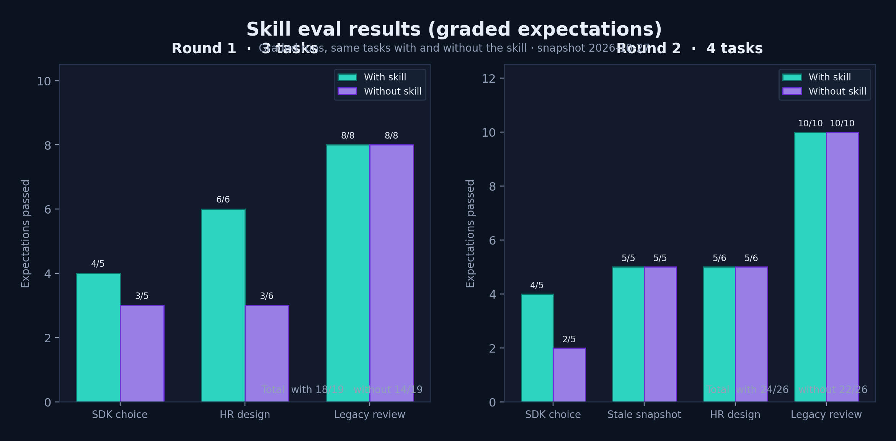

# skill

[`building-ai-agents`](building-ai-agents/SKILL.md) is the guide rewritten for a coding agent. Install it, and when Claude Code or Codex is asked to build, design, review or upgrade an AI agent, it loads the skill and follows it instead of its training-time memory.

```
powershell -ExecutionPolicy Bypass -File scripts\install-skill.ps1     # Windows, from the repo root
sh scripts/install-skill.sh                                            # macOS, Linux, WSL
```

## What it does

**Step 0 is a freshness check, every time.** Model names, SDK versions, spec revisions and API parameters change monthly, so the skill treats every one of them as a hypothesis. [`scripts/check_freshness.py`](building-ai-agents/scripts/check_freshness.py) asks the package registries, GitHub and the MCP spec site what is current and diffs it against the snapshot; `--audit name==version` looks up known advisories for pinned versions in OSV. The agent then reads vendor release notes and deprecation pages, and records what it found, with dates and sources, in the project's stack lock.

```
python skill/building-ai-agents/scripts/check_freshness.py --no-models
python skill/building-ai-agents/scripts/check_freshness.py --no-models --audit mcp==2.3.0 langchain-core==0.1.53
```

Then Steps 1–7: write the spec (including whether to buy instead of build), choose the simplest architecture that will pass, write the evals before the code, build the ten layers in order, threat-model, ship through the gate, hand off.

## What is inside

| Path | Contents |
| --- | --- |
| [`SKILL.md`](building-ai-agents/SKILL.md) | The workflow, ten non-negotiables, and when to read which file |
| [`references/01`…`10`](building-ai-agents/references/) | One file per layer: default, decision rules, checklist, anti-patterns, a "verify before relying" table of volatile facts, sources |
| [`references/architecture-patterns.md`](building-ai-agents/references/architecture-patterns.md) | Workflow vs single agent vs multi-agent, long-running agents, durable execution |
| [`references/agent-ux-design.md`](building-ai-agents/references/agent-ux-design.md) | Identity, progress, confirmations, citations, undo, handoff |
| [`references/failure-modes.md`](building-ai-agents/references/failure-modes.md) | The failure catalogue, invariants, cross-layer gaps and an audit procedure |
| [`references/practices-register.md`](building-ai-agents/references/practices-register.md) | Techniques reviewed and judged adopt / adopt-when / watch / skip, with sources (Cache-to-Cache, KV-cache-first context, Karpathy's workflow, 12-Factor Agents, Ralph loops, LLM councils, and more) |
| [`templates/`](building-ai-agents/templates/) | Agent spec, eval plan, threat model, stack lock |
| [`evals/`](building-ai-agents/evals/) | Four test cases with graders, in the layout `claude plugin eval` reads |

## How well it works

Each case was run twice on the same model with web access, once with the skill and once without, and graded against fixed assertions.

| Round | Cases | With the skill | Without |
| --- | --- | --- | --- |
| 1 | design an HR assistant; modernize a 2024 support agent; pick a model and SDK for 200 tools | 18 / 19 | 14 / 19 |
| 2 | the same three, plus a copy of the skill with its snapshot backdated seven months | 24 / 26 | 22 / 26 |

Without the skill, runs missed permission-aware retrieval, identity regression tests and idempotent writes, and quoted list prices. With a backdated snapshot, the skill still found the current MCP revision and SDK versions and listed every place its snapshot was wrong. Changes made after round 2 (advisory lookups, the practices register) have not been re-run yet.

<p align="center">
  
</p>
