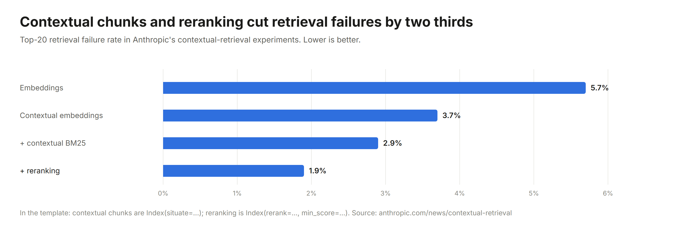

# Upgrade ladders

**Verified 2026-10-28.** For every layer of an agent, the best-known methods in the order you should reach for them: rung 0 is what [`template/`](../template) does out of the box, and each rung above adds capability, cost or both. Climb one rung at a time, and only when a case in your own eval suite fails on the rung below. A rung you do not need is a failure surface you do not have.

Each row gives what the rung adds, the measured evidence (with its source and date), when to climb to it, and where it plugs into the template. Figures marked *vendor-reported* come from the vendor of the thing measured; measure on your own evals. Names, versions and leaderboard positions are **volatile**: run `python skill/building-ai-agents/scripts/check_freshness.py` and open the linked source before relying on one. No prices are listed; cost appears as mechanisms.

**Contents:** [Retrieval](#retrieval) · [Prompt injection and hijacking](#prompt-injection-and-hijacking) · [Moderation of prompts, data and outputs](#moderation-of-prompts-data-and-outputs) · [Model and harness](#model-and-harness) · [Context](#context) · [Tools and actions](#tools-and-actions) · [Memory](#memory) · [Identity and authorization](#identity-and-authorization) · [Cost and latency](#cost-and-latency) · [Observability](#observability) · [Evals and release](#evals-and-release)

## Retrieval

The retriever still decides most of the result, even inside an agent that searches on its own: on BrowseComp-Plus, swapping BM25 for a strong embedder under the same GPT-5 agent raised accuracy from 55.9% to 70.1% with fewer searches ([arXiv 2508.06600](https://arxiv.org/abs/2508.06600)). Climb the retriever before you climb the reasoning around it.

  

| # | Rung | What it adds | Evidence | Climb when | Template |
| --- | --- | --- | --- | --- | --- |
| 0 | Structure-aware chunks, ACL filter before ranking, BM25, abstain, cite | A grounded answer or an honest "not found", and no leak through search | — | Start here | `Index`, `search_tool` |
| 1 | Hybrid: BM25 + dense, fused | Paraphrases from the dense leg; identifiers, codes and names from the lexical leg | GPT-5 agent accuracy 55.9% → 70.1% with BM25 → Qwen3-Embedding-8B ([arXiv 2508.06600](https://arxiv.org/abs/2508.06600)). A tuned convex combination of normalized scores beat RRF in and out of domain ([Bruch et al.](https://arxiv.org/abs/2210.11934)) | Users phrase things differently from the documents. Start with RRF; switch to a convex combination once a golden set can tune its weight | `Index(embed=Embeddings(...))` |
| 2 | Contextual chunks | A sentence that places each chunk in its document, in both the dense and the BM25 text; late chunking when an LLM call per chunk is not allowed | Top-20 retrieval failures 5.7% → 3.7% (contextual embeddings) → 2.9% (plus contextual BM25) ([Anthropic](https://www.anthropic.com/news/contextual-retrieval)) · [late chunking](https://arxiv.org/abs/2409.04701) | Chunks lose their meaning out of context ("it", "the above", "this plan") | `Index(situate=...)` |
| 3 | Rerank, then a calibrated threshold | A cross-encoder rescores about 150 candidates; only what clears the threshold reaches the model, and below it the agent re-queries or abstains (the useful part of CRAG) | → 1.9% failures with reranking ([Anthropic](https://www.anthropic.com/news/contextual-retrieval)); a reranker inside an agent: accuracy 46% → 58% with 35% fewer tokens (Cohere-reported, [Rerank 5](https://cohere.com/blog/rerank-5)); CRAG grading on LLaMA2-7b: PopQA 50.5 → 54.9 ([arXiv 2401.15884](https://arxiv.org/abs/2401.15884)) | Almost always; this is the best value rung. Score scales differ between rerankers, so calibrate `min_score` per model | `Index(rerank=Reranker(...), min_score=...)` |
| 4 | Layout parsing, plus a page-image path | Reading order, tables and OCR for text; late-interaction page-image retrieval for slides, scans and charts | ViDoRe v1&v2: Argus-Colqwen3.5-9b-v0 85.98 (Apache-2.0) against ColPali v1.3 76.17, read 2026-10-28 ([board](https://mteb-leaderboard.hf.space/benchmark/ViDoRe(v1%26v2))). `colpali-engine` is deprecated in favour of Sentence Transformers | Meaning lives in layout | Parse into `Doc` text with [Docling](https://github.com/docling-project/docling); add page images as a second search tool |
| 5 | Learned sparse as the lexical leg | Term weights and expansion from an inverted index | SPLADE-v3: 51.7 nDCG@10 on BEIR-13 ([arXiv 2403.06789](https://arxiv.org/abs/2403.06789), weights CC BY-NC-SA). Apache-2.0 options: `opensearch-neural-sparse-encoding-doc-v3-gte` (BEIR 0.546, inference-free queries); for Korean, `telepix/PIXIE-Splade-v1.5` (75.59 on MTEB kor retrieval) | BM25 misses paraphrases and your engine stores sparse vectors | Replace `Index._bm25` |
| 6 | Late interaction for text (ColBERT) | One vector per token, scored with MaxSim; also a cheap reranker | PLAID: up to 7× (GPU) and 45× (CPU) faster ColBERTv2 search ([arXiv 2205.09707](https://arxiv.org/abs/2205.09707)); GTE-ModernColBERT-v1 BEIR 54.67, author-reported ([PyLate](https://github.com/lightonai/pylate)) | Single-vector recall stalls on out-of-domain or long documents | A search tool backed by PyLate |
| 7 | Agentic search | The model searches, reads and rewrites its queries until it has the evidence | Frontier agents average 22–26 searches per question on BrowseComp-Plus; RL-trained 32B searchers reach 3.9–10.4% where GPT-5 reaches 55.9–70.1% ([arXiv 2508.06600](https://arxiv.org/abs/2508.06600)) | Questions need several lookups; use a frontier model | `search_tool` already allows it; raise `Agent(max_steps=...)` |
| 8 | Multi-hop retrieval | Retrieval at each reasoning step, or a graph that links facts across documents | IRCoT: up to +21 retrieval and +15 QA points on multi-hop sets ([arXiv 2212.10509](https://arxiv.org/abs/2212.10509)); HippoRAG 2: HotpotQA F1 63.01 ([arXiv 2502.14802](https://arxiv.org/abs/2502.14802)) | The golden set is multi-hop. Build it as the agent loop, not a fixed pipeline | — |
| 9 | Corpus-level structure | LazyGraphRAG for whole-corpus questions; RAPTOR trees for long single documents | On single-hop lookups, vanilla or reranked RAG beat GraphRAG ([sota §4](README.md#4-retrieval)) | "What are the main themes across all incident reports?" | — |
| 10 | Context pruning fused into the reranker | Irrelevant sentences dropped in the same pass that ranks | Cohere Rerank 5 Context Focus kept 96% of answer quality at half the text (vendor-reported); Provence: "negligible to no drop" ([arXiv 2501.16214](https://arxiv.org/abs/2501.16214), weights non-commercial) | Context tokens or time to first token dominate | — |

**Not by default.** HyDE and other generated query expansions help weak retrievers and hurt strong ones, across 24 retrievers ([arXiv 2309.08541](https://arxiv.org/abs/2309.08541)); the exception is reasoning-heavy queries, where LLM reasoning about the query added up to 12.2 points on BRIGHT ([arXiv 2407.12883](https://arxiv.org/abs/2407.12883)). RAG-Fusion's recall gain was "largely neutralized after re-ranking", with Hit@10 0.51 → 0.48 in a 2026 deployment ([arXiv 2603.02153](https://arxiv.org/abs/2603.02153v1)). Self-RAG needs its own fine-tuned model and collapses without it (PopQA 29.0), so it cannot sit in front of an API model. Standalone token-dropping compressors (LLMLingua, last released 2024) lose to pruning fused into the reranker.

**Poisoned documents.** Five crafted texts per target question among millions reached 90% attack success ([PoisonedRAG](https://arxiv.org/abs/2402.07867)), and a 2025 benchmark found that current defenses "fail to provide robust protection" ([RAG Security Bench](https://arxiv.org/abs/2505.18543)). TrustRAG (author-reported) and RobustRAG's isolate-then-aggregate lower attack success at the price of extra model calls; no defense holds against adaptive attackers. The controls that do hold sit at ingestion: restrict who can write to the corpus, keep provenance on every chunk, clean documents before indexing (`Guard.documents`), and treat every retrieved passage as untrusted (`search_tool` marks it so).

**Current leaders, read 2026-10-28** (volatile; licences checked on the model card):

| Area | Leaders | Source |
| --- | --- | --- |
| Multilingual embedders | `microsoft/harrier-oss-v1-27b` 74.27 (MIT; 78% of tasks zero-shot), `tencent/KaLM-Embedding-Gemma3-12B-2511` 72.32, `Qwen/Qwen3-Embedding-8B` 70.58; small: `harrier-oss-v1-0.6b` 69.01 | [MMTEB v2](https://mteb-leaderboard.hf.space/benchmark/MTEB(Multilingual%2C%20v2)) |
| Retrieval-only embedders | 1 `voyage-4-large`, 2 `nvidia/Nemotron-3-Embed-8B-BF16`, 3 `Octen/Octen-Embedding-8B` (ranks only; scores hidden) | [RTEB beta](https://mteb-leaderboard.hf.space/benchmark/RTEB(beta)) |
| Korean | `Qwen3-Embedding-8B` 77.78; 568M fine-tunes `nlpai-lab/KURE-v1` (MIT) 75.90 retrieval, `telepix/PIXIE-Rune-v1.5` 75.92 | [MTEB kor v2](https://mteb-leaderboard.hf.space/benchmark/MTEB(kor%2C%20v2)) |
| Rerankers | No neutral board covers the October 2026 releases. Cohere Rerank 5, Voyage rerank-3 (vendor-reported); `Qwen/Qwen3-Reranker-8B` (Apache-2.0) for self-hosting | [Agentset ELO](https://agentset.ai/rerankers) (2026-02-15) |
| Reasoning-heavy retrieval | Reasoning and agentic systems lead (Mira-Reasoning-Retrieval 66.9); the best single embedder scores 27.20 | [BRIGHT](https://brightbenchmark.github.io/) |
| Page images | `Argus-Colqwen3.5-9b-v0` 85.98 (Apache-2.0), `colnomic-embed-multimodal-7b` 81.30 (Apache-2.0) | [ViDoRe v1&v2](https://mteb-leaderboard.hf.space/benchmark/ViDoRe(v1%26v2)) |

Non-commercial weights to check before shipping: `naver/splade-v3`, Provence and XProvence, `nvidia/nemotron-colembed-vl-8b-v2`, `zerank-2`, Jina reranker v3.5. The template's `Reranker` reads Cohere v2, Jina and vLLM (`results`), Voyage (`data`) and Hugging Face TEI (pass `field="texts"`; bare list); `Embeddings` speaks the OpenAI `/embeddings` shape that OpenAI, vLLM and TEI all serve.

## Prompt injection and hijacking

Nothing makes an agent unhackable. Under adaptive attack, every model-side defense eventually broke: search-based attackers pushed spotlighting and sandwiching above 95% success, Prompt Guard 2 above 90%, PIGuard to 71%, MELON to 76% and Meta SecAlign from 2% to 96% ([Nasr et al., 2025-10](https://arxiv.org/abs/2510.09023)). Across 20,000 attacks on nine configurations, the one control that held was code outside the model: output filtering in application code leaked nothing in 15,000 attempts ([Deep et al., 2026-05](https://arxiv.org/abs/2604.23887)). So the ladder starts with rules that hold *by construction* (whatever the model does) and adds probabilistic layers on top, never in place of them.

| # | Rung | What it adds | Evidence | Climb when | Template |
| --- | --- | --- | --- | --- | --- |
| 0 | Rules in code *(by construction)* | The user's own permissions per call; no outbound send after private + untrusted data without a person; lockdown; writes run once; invisible characters stripped; answers and messages cannot reach unlisted hosts | See above | Start here | `Policy`, `Toolbox(lockdown=True)`, `Guard` |
| 1 | Injection-robust models *(probabilistic)* | Lower base rates on every input, chosen at model selection | Meta SecAlign-70B: AgentDojo attack success 14.7% → 1.9% with utility 59.8% → 84.5%; InjecAgent 53.8% → 0.5% ([v4, 2026-09-28](https://arxiv.org/abs/2507.02735)). OpenAI's IH-Challenge training: instruction-hierarchy robustness 84.1% → 94.1% over 16 benchmarks ([2026-03-11](https://arxiv.org/abs/2603.10521)) | Always, when choosing a model; never as the boundary | `--model` |
| 2 | Injection detectors as telemetry *(probabilistic)* | A signal to log, and to drop the session to read-only | Llama Prompt Guard 2 (86M / 22M, 512-token window): 81.2% / 78.4% of AgentDojo attacks stopped at 3% utility loss, vendor-reported ([card](https://huggingface.co/meta-llama/Llama-Prompt-Guard-2-86M)). A detector cut GPT-4o's benign AgentDojo utility from 80.4% to 38.1% ([MELON, Table 1](https://arxiv.org/abs/2502.05174)) | You need to see attacks in traces | `Guard(classify=..., classify_data=True)` |
| 3 | Tool and URL provenance *(by construction)* | Pin each MCP tool definition by SHA-256 and hide changed tools until a person re-approves the diff. Fetch only URLs that appeared verbatim in a user message or a trusted result; block private address ranges and check every redirect | Tool poisoning reached 72.8% success on o1-mini, with refusals under 3% ([MCPTox](https://arxiv.org/abs/2508.14925)); rug pulls and shadowing ([Invariant Labs](https://invariantlabs.ai/blog/mcp-security-notification-tool-poisoning-attacks)); fetch rules ([Anthropic web fetch](https://platform.claude.com/docs/en/agents-and-tools/tool-use/web-fetch-tool)) | Tools come from other people's MCP servers, or the agent can fetch or browse | The release bundle already hashes tool schemas; add a URL rule to the fetch tool's `Policy` |
| 4 | Argument-level privilege policies *(by construction for what they forbid)* | Allowed recipients, domains, paths and values per tool; narrowing at run time is automatic, widening needs approval | Progent with hand-written policies: 0% attack success on AgentDojo and ASB ([arXiv 2504.11703](https://arxiv.org/abs/2504.11703), [code](https://github.com/sunblaze-ucb/progent)); an independent rerun on Qwen2.5-7B: 25.8% → 4.2% ([2026-06](https://arxiv.org/abs/2606.26479)) | Allowed tools can be pointed at the wrong target | `Policy` rules over `args` (`only_values`, `own_records`) |
| 5 | Planner plus validator *(LLM-written rules, enforced in code)* | A trusted plan fixes which calls may happen; a validator enforces it | DRIFT on GPT-4o: 51.68% → 1.66% attack success with utility 70.86% → 71.61% ([NeurIPS 2025](https://arxiv.org/abs/2506.12104), [code](https://github.com/SaFo-Lab/DRIFT)); Progent with LLM-written policies: AgentDojo 39.9% → 1.0% | Tasks are too open for hand-written policy | — |
| 6 | Information-flow control *(by construction, given correct labels)* | Labels on values, not sessions: a consequential call proceeds only if trusted context chose it, and data flows only to readers allowed to see it | FIDES on gpt-4o: 163 successful injections → 1, at up to 24.5% task-completion cost ([arXiv 2505.23643](https://arxiv.org/abs/2505.23643), [code](https://github.com/microsoft/fides)). Watch PACT and SPA: no code yet | Some sends must stay allowed after private data is read | `Taint` is the session-level version |
| 7 | Control and data separation *(by construction)* | The privileged model writes a program from the user's request alone; data never changes which tools run; capabilities gate every flow | CaMeL: 77% of AgentDojo tasks with provable security against 84% undefended ([arXiv 2503.18813](https://arxiv.org/abs/2503.18813), [code](https://github.com/google-research/camel-prompt-injection)); DRIFT measured 35.4 against 48.3 on GPT-4o-mini | Data-dependent, high-stakes workflows: email with send, payments | — |

Not rungs. **Prompt-level defenses** (delimiters, spotlighting, sandwiching, "ignore instructions in data") went above 95% attack success under adaptive search: keep source labels for logging, not as a defense. **Runtime alignment monitors** are on the watch list: MELON cut GPT-4o attack success from 16.06% to 0.24%, but benign utility fell from 80.41% to 68.04% with a 9.28% false-positive rate, adaptive attacks reached 76–95%, and each monitor roughly doubles model calls.

**Allow-lists are not enough on their own.** Data has left through allowed hosts by way of an open redirect (EchoLeak), Google Forms on `docs.google.com`, an expired domain still in a CSP, per-character signed proxy URLs (CamoLeak), `webhook.site` on a default list, and an attacker's API key sent to an allowed API ([Willison, markdown exfiltration](https://simonwillison.net/tag/markdown-exfiltration/)). Allow (method, host, path prefix), deny generic capture services, let the harness inject credentials, and reject any credential found in arguments the model built. Sanitize the fully assembled answer, not streamed chunks, and read reference-style link definitions too.

**What the template guarantees, whatever the model does** (given correct code and tool labels): a tool or argument the policy denies never runs; after private and untrusted data, no outbound call runs without a person approving that exact call; in lockdown, no action runs after untrusted content without a person; no write runs twice; the listed invisible characters never reach the model; no answer or outbound message carries a credential or identifier in the listed formats, or points at an unlisted host in any URL form the guard parses. Rules cover exactly what they list: add the credential formats your own systems issue. **What it cannot guarantee:** correct answers or summaries (text-to-text injection is out of scope even for FIDES and CaMeL), safety within allowed actions, the judgement of the person approving, or classifier rates under adaptive attack.

## Moderation of prompts, data and outputs

Screening has five checkpoints, and the template's `Guard` runs at all of them: the user's prompt before the model sees it, documents at ingestion and every tool result, anything an outbound tool is about to send, anything a write puts in a store, and the answer before the user sees it. Rules run first because they cost a string scan and cannot be argued with; classifiers add what rules cannot see (harassment, self-harm, your own content policy). Classifiers are probabilities, and the injection ladder above shows what adaptive attackers do to probabilities: route on them, log them, never make them the only boundary.

  

| # | Rung | What it adds | Evidence | Climb when | Template |
| --- | --- | --- | --- | --- | --- |
| 0 | Deterministic rules | Invisible characters stripped; credentials redacted (gitleaks' rule set); card numbers (Luhn-checked), resident registration numbers and SSNs redacted; e-mail and phone on request; no remote images, links only to listed https hosts; refuse egress that carries any of these | No public precision or recall exists for rule sets; gitleaks pairs most rules with an entropy floor to cut false positives ([rules](https://github.com/gitleaks/gitleaks/blob/master/config/gitleaks.toml)) | Start here, on every surface | `Guard()` |
| 1 | A hosted moderation API | Harm categories without a GPU. OpenAI `omni-moderation-latest`: 13 categories, text and images, no PII, injection or custom policy. Azure Prompt Shields: its `documents` field checks retrieved content for injected instructions. Google Model Armor and AWS Bedrock Guardrails add PII masking and prompt-attack filters | None of the four publishes F1 on public test sets; measure on your own traffic ([OpenAI](https://developers.openai.com/api/docs/guides/moderation), [Azure](https://learn.microsoft.com/en-us/azure/ai-services/content-safety/quickstart-jailbreak), [Model Armor](https://docs.cloud.google.com/security-command-center/docs/sanitize-prompts-responses), [Bedrock](https://docs.aws.amazon.com/bedrock/latest/APIReference/API_runtime_ApplyGuardrail.html)) | No GPU, and your data terms allow sending content out. Azure's models were not trained on Korean | `Guard(classify=OpenAIModeration())` |
| 2 | An open guard model with a fixed taxonomy | Prompt and response labels on your own hardware. Default: **Qwen3Guard-Gen** (0.6B / 4B / 8B, Apache-2.0, 119 languages, Korean 9.91% of training data). For Korean-only products: **Kanana Safeguard** (Kakao, Apache-2.0) | Qwen3Guard-Gen-8B, English prompt F1 90.0 against 75.9 for Llama Guard 4 and 85.8 for WildGuard; response F1 83.9 against 67.5 and 79.9 (vendor-run, [arXiv 2510.14276](https://arxiv.org/abs/2510.14276)). Kanana Safeguard 8B: F1 0.946 on Kakao's Korean test set, against 0.540 for Llama Guard 3 (vendor-run, [card](https://huggingface.co/kakaocorp/kanana-safeguard-8b)) | Content must stay on your infrastructure, or you need Korean | `GuardModel(..., format="qwen3guard")` or `format="llama-guard"` |
| 3 | A policy-following guard | Your own policy in plain language, with a rationale reviewers can read: **gpt-oss-safeguard** (20B / 120B, Apache-2.0), **Shieldstral** (3B, Apache-2.0, Korean listed), Nemotron 3.5 Content Safety (`custom_policy`, Korean listed), Granite Guardian 4.1 (English only) | gpt-oss-safeguard-20b: OpenAI Moderation F1 82.9, ToxicChat 79.9 ([report](https://cdn.openai.com/pdf/08b7dee4-8bc6-4955-a219-7793fb69090c/Technical_report__Research_Preview_of_gpt_oss_safeguard.pdf)); OpenAI runs it asynchronously behind small, fast classifiers because reasoning on every call is slow. Shieldstral: ToxicChat 84.1 (vendor-run, [Mistral](https://mistral.ai/news/shieldstral/)) | Your rules are not the stock taxonomy: tenant rules, limits on professional advice, community standards. Send only the cases rung 2 finds ambiguous | `GuardModel(..., format="policy", policy=...)` |
| 4 | A streaming guard | A verdict per generated token, so a long answer can be stopped mid-stream | Qwen3Guard-Stream-4B matched Gen-4B within 0.2 points on prompts, and its first flag fell inside the unsafe sentence on about 86% of responses (vendor-run); vLLM support is pending | Long streamed answers where waiting for the end hurts | — (the template screens the finished answer) |

**Korean coverage**, checked on each card: Qwen3Guard, Kanana Safeguard, Nemotron 3.5 Content Safety and Shieldstral list Korean; Llama Guard 4, Llama Prompt Guard 2, Granite Guardian 4.1 and Azure's content-safety models do not.

**Personal data in free text.** Rules catch structured identifiers; names, addresses and account numbers in prose need a model. [OpenAI Privacy Filter](https://huggingface.co/openai/privacy-filter) (2026-04, Apache-2.0, 50M active parameters, 128K context) reports F1 96% on PII-Masking-300k, mostly English, and says it is "not an anonymization, compliance, or a safety guarantee". [Presidio](https://github.com/data-privacy-stack/presidio), now community-owned, has Korean recognizers (`KR_RRN`, `KR_FRN`, `KR_DRIVER_LICENSE`, `KR_PASSPORT`, `KR_BRN`) but needs spaCy. No learned PII model found lists Korean, so for Korean use rules for identifiers and a Korean-capable guard to flag requests for personal data. Numbers issued since October 2020 end in random digits, so a failed resident-number checksum must never clear a match.

**Secrets.** The template's patterns follow gitleaks' default rules. If you also run trufflehog, turn its verification off on user data: it confirms a key by sending it to the provider.

**Frameworks.** NVIDIA NeMo Guardrails (0.24.1, 2026-09-16) is maintained and worth it when you want configuration-driven rails around a chat app. Protect AI's LLM Guard was archived on 2026-07-09: borrow its ideas, not its code. Meta's LlamaFirewall has had no release since 2025-05; watch it.

## Model and harness

| # | Rung | What it adds | Evidence | Climb when | Template |
| --- | --- | --- | --- | --- | --- |
| 0 | One pinned model, a loop you can read | The model proposes, code disposes; model id is configuration | — | Start here | `Agent`, `Anthropic`, `OpenAICompatible` |
| 1 | Schema-constrained output | Claude `output_config.format`, OpenAI `text.format` with `strict: true`, Gemini `response_format`; still validate, because refusals and truncation escape the schema | Vendor docs ([sota §1](README.md#1-models)) | Code parses model output and your evals show parse failures | Validate in the tool function |
| 2 | Effort per workload, a small tier for routing and extraction | All three vendors steer reasoning with named effort levels and recalibrate defaults between models | Vendor docs, 2026-10-27 | Latency or cost misses its budget with quality to spare | `model_id` + adapter settings, part of the release bundle |
| 3 | A vendor harness | Compaction, sub-agents, sessions, permissions and hooks you would otherwise rebuild: Claude Agent SDK, OpenAI Agents SDK, Google ADK, Microsoft Agent Framework, LangGraph | [sota §2](README.md#2-agent-sdks-and-harnesses) | You need compaction, sub-agents or resumable sessions | Keep `policy`, `guard` and `evals` as the rules around it |
| 4 | Durable execution | Each model and tool call becomes a checkpointed step that survives deploys and crashes and can wait days for a person: Temporal, Restate, DBOS | Temporal × OpenAI Agents SDK GA 2026-03-23 | Runs outlive a process, or wait on people for hours | Keep the idempotency ledger's keys |
| 5 | Orchestrator with sub-agents | Parallel breadth and context isolation | Multi-agent runs use about 15× the tokens of a chat, a single agent about 4× ([Anthropic](https://www.anthropic.com/engineering/multi-agent-research-system)) | Independent subtasks dominate and a single agent fails the evals | Read-only workers, one writer |

## Context

| # | Rung | What it adds | Evidence | Climb when | Template |
| --- | --- | --- | --- | --- | --- |
| 0 | Frozen prefix, sorted tools, append-only history | The cache-friendly shape every provider rewards | Agent traces are 94–96% reusable prefix ([vLLM](https://vllm.ai/blog/2026-09-08-vllm-agentx)); Manus reports input:output near 100:1 ([Manus](https://manus.im/blog/Context-Engineering-for-AI-Agents-Lessons-from-Building-Manus)) | Start here | `Session`, `fingerprint`, `dumps` |
| 1 | Provider prompt caching | Reuse of the stable prefix across turns | Vendor docs ([sota §8](README.md#8-cost-and-serving)) | Always, once the prefix is stable | `Anthropic` marks the system prompt cacheable |
| 2 | Agent Skills for procedures | Only names and descriptions (about 100 tokens each) load at start; bodies load on use | [agentskills.io](https://agentskills.io/specification) | The system prompt grows past a page of procedures | Load `SKILL.md` bodies as a read tool |
| 3 | Tool search with deferred loading | Past about 10 tools or 10k tokens of definitions; selection accuracy degrades past 30–50 loaded tools | [Claude docs](https://platform.claude.com/docs/en/agents-and-tools/tool-use/tool-search-tool) | Tool definitions crowd the context or the wrong tool gets picked | `Toolbox.schemas` filters by user today |
| 4 | Programmatic tool calling | The model writes sandboxed code that chains read and aggregate tools, so intermediate results stay out of context | Gained nothing on sequential τ²-bench flows ([docs](https://platform.claude.com/docs/en/agents-and-tools/tool-use/programmatic-tool-calling)) | Many reads feed one aggregate | Not in the template; keep writes as direct calls |

## Tools and actions

| # | Rung | What it adds | Evidence | Climb when | Template |
| --- | --- | --- | --- | --- | --- |
| 0 | Typed tools, deny-by-default policy, approvals, idempotency | read / write / irreversible enforced in code; errors as sentences | Approval does not guarantee exactly-once execution; keys do ([OpenAI](https://openai.github.io/openai-agents-python/human_in_the_loop/)) | Start here | `Tool`, `Toolbox`, `Policy` |
| 1 | Lockdown | After any untrusted content, every action needs a person | The Rule of Two ([Meta](https://ai.meta.com/blog/practical-ai-agent-security/)) | The agent reads untrusted text and can act | `Toolbox(lockdown=True)` |
| 2 | MCP servers on the current spec, pinned and allow-listed | Standard tool transport; diff tool descriptions on every update | MCP 2026-07-28 ([changelog](https://modelcontextprotocol.io/specification/2026-07-28/changelog)) | Tools live in other teams' systems | Wrap each MCP tool as a `Tool` with a policy rule |
| 3 | Mid-call confirmation (MCP MRTR) | Approvals and missing input mid-call, bound to the principal | [MRTR](https://modelcontextprotocol.io/specification/2026-07-28/basic/patterns/mrtr) | Servers need input during a call | `Pending` / `resume` |
| 4 | Sandboxed code and shell | Filesystem and network isolation, egress through an allow-list proxy | Claude Code's sandbox cut permission prompts by 84% internally ([Anthropic](https://www.anthropic.com/engineering/claude-code-sandboxing)) | The agent runs code, shells or packages | Not in the template; run tools in the sandbox |

## Memory

| # | Rung | What it adds | Evidence | Climb when | Template |
| --- | --- | --- | --- | --- | --- |
| 0 | Append-only session, restorable tool-result clearing | Long loops stay within the window without losing data | KV-cache-first design ([Manus](https://manus.im/blog/Context-Engineering-for-AI-Agents-Lessons-from-Building-Manus)) | Start here | `Session.clear_old_tool_results` |
| 1 | Provider or harness compaction | Summaries the provider or harness keeps consistent with its cache | Vendor docs ([sota §6](README.md#6-memory-and-context)) | Sessions outgrow the window | Use the harness's, not a hand-written summarizer |
| 2 | File-style durable memory | Per-user memory with provenance, read-only where writing is not needed | [Claude memory tool](https://platform.claude.com/docs/en/agents-and-tools/tool-use/memory-tool) | Users expect the agent to remember across sessions | A read tool plus a guarded write tool; screen with `Guard.data` |
| 3 | Sub-agents with clean context | Exploration in isolated windows returning 1–2k-token summaries | [Claude Agent SDK](https://code.claude.com/docs/en/agent-sdk/subagents) | One task floods the context with search results | — |
| 4 | Entity-graph memory | Facts that change over time, shared across apps: Graphiti, mem0 | [Graphiti](https://github.com/getzep/graphiti) | Memory must move across vendors or track changing entities | — |

Memory is untrusted data: an injection written to memory replays in every later session.

## Identity and authorization

| # | Rung | What it adds | Evidence | Climb when | Template |
| --- | --- | --- | --- | --- | --- |
| 0 | The user's own permissions, per call and per document | A fooled model can never do more than its user | — | Start here | `Policy`, `Doc.acl` |
| 1 | Delegated OAuth tokens naming user and agent; MCP authorization | Audience-checked tokens; RFC 8707 resource indicators | Without the audience check a server accepts other servers' tokens ([GHSA-w4fh-qvv9-3v23](https://github.com/modelcontextprotocol/python-sdk/security/advisories/GHSA-w4fh-qvv9-3v23)) | Tools call real systems | Pass the user's token to `fn(user=...)` |
| 2 | A policy engine outside the code | OpenFGA checks on every retrieval; Cedar at the tool gateway | [OpenFGA](https://openfga.dev/docs/modeling/agents/rag-authorization) · [Cedar](https://docs.cedarpolicy.com/auth/authorization.html) | Rules outgrow functions, or auditors need them | A `Policy` rule that calls the engine |
| 3 | Enterprise-managed authorization (ID-JAG) | IT policy replaces per-server consent for workforce agents | MCP extension, stable at 2026-07-28 ([ext-auth](https://github.com/modelcontextprotocol/ext-auth)) | A workforce deployment with a corporate IdP | — |
| 4 | Out-of-band approval (CIBA), workload identity | High-impact approvals decided by the authorization server; one identity per agent | [CIBA](https://openid.net/specs/openid-client-initiated-backchannel-authentication-core-1_0.html) · [SPIFFE](https://spiffe.io/docs/latest/spiffe-about/overview/) | Money, personal data or external communication | `Pending` routed to the approver |

## Cost and latency

| # | Rung | What it adds | Evidence | Climb when | Template |
| --- | --- | --- | --- | --- | --- |
| 0 | A stable prefix | Prompt caches reuse it | See Context, rung 0 | Start here | `fingerprint` |
| 1 | Effort per workload, small tier where it passes | Fewer reasoning tokens where they do not change the answer | Vendor docs | Quality has headroom | Release-bundle settings |
| 2 | Batch and flex for offline work | Separate capacity, traded for latency | Vendor docs ([sota §8](README.md#8-cost-and-serving)) | Evals, backfills, enrichment | Run `kit.evals` through a batch adapter |
| 3 | Self-hosted serving | vLLM or SGLang prefix caching with a per-tenant `cache_salt`; KV offloading; KV-aware routing | llm-d: p90 TTFT 0.54 s against 92.6 s with random routing ([llm-d](https://llm-d.ai/blog/kvcache-wins-you-can-see)) | Residency, licensing or volume | `OpenAICompatible(base_url=...)` |
| 4 | A router behind the evals | Easy queries to small models, pinned per session | [RouteLLM](https://arxiv.org/abs/2406.18665) | Mixed traffic with a clear easy share | Log the served model on every span |

Do not put a semantic response cache in front of an agent: CacheAttack hijacked responses at an 86% hit rate ([arXiv 2601.23088](https://arxiv.org/abs/2601.23088)).

## Observability

| # | Rung | What it adds | Evidence | Climb when | Template |
| --- | --- | --- | --- | --- | --- |
| 0 | One JSON line per step, GenAI span names, release version, content off | Replayable failures without leaking content | — | Start here | `Tracer` |
| 1 | OpenTelemetry export through a Collector | Redaction processor in allow-list mode with HMAC hashing; tail sampling that keeps every error and denial | [redaction processor](https://github.com/open-telemetry/opentelemetry-collector-contrib/blob/main/processor/redactionprocessor/README.md) | More than one service, or a team that reads traces | Map each JSON line to a span |
| 2 | An LLM observability backend | Langfuse, Datadog, LangSmith, Braintrust and others ingest OTLP | [sota §9](README.md#9-observability) | People triage failures from traces | — |
| 3 | Online evaluators | Sampled production traces scored and written back | [LangSmith](https://docs.langchain.com/langsmith/online-evaluations) | Production traffic differs from the golden set | Re-run `kit.evals` checks on sampled traces |
| 4 | MCP trace propagation | `traceparent` in `params._meta`, one span per tool call across services | [MCP semconv](https://github.com/open-telemetry/semantic-conventions-genai/blob/main/docs/gen-ai/mcp.md) | Tools run in other services | — |

## Evals and release

| # | Rung | What it adds | Evidence | Climb when | Template |
| --- | --- | --- | --- | --- | --- |
| 0 | Cases, pass^k, a gate in CI, one release hash | A prompt edit is a release; "usually works" does not ship | 75% per trial is about 42% pass^3 | Start here | `kit.evals`, `bundle` |
| 1 | Deterministic state graders, then trace graders | Checks on what the agent did, not only what it said | [sota §10](README.md#10-evals-and-benchmarks) | Answers look right but actions are wrong | `called`, `not_called`, `writes`, `unseen` |
| 2 | Red-team scans in CI | Injection, jailbreak and memory-poisoning probes on every change | [promptfoo](https://www.promptfoo.dev/docs/integrations/ci-cd/) | Any agent that reads untrusted content | Add the findings as safety cases |
| 3 | Sandboxed agent tasks | Real environments (Docker, Kubernetes) with graded end states | [Inspect](https://inspect.aisi.org.uk/) | Agents that change files, shells or systems | — |
| 4 | Calibrated judges, online evals, staged rollout | LLM judges checked with Cohen's kappa against people; shadow, canary, ramp with rollback triggers | Exact-match agreement overstated judge validity by 33–41 points (June 2026 preprints, not peer-reviewed) | Open-ended quality the code cannot grade | — |
